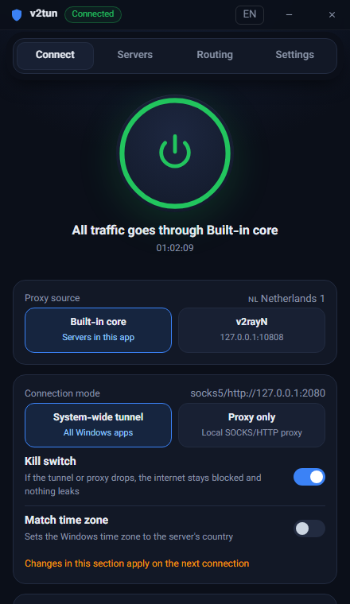
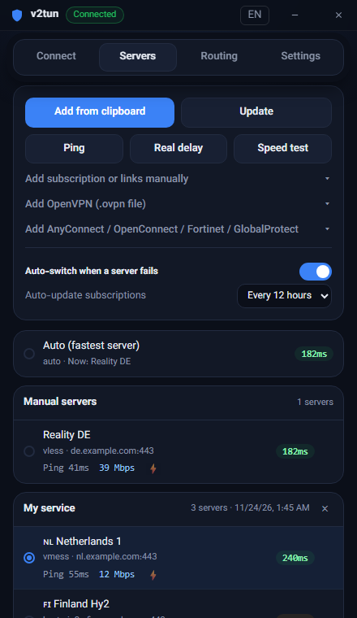
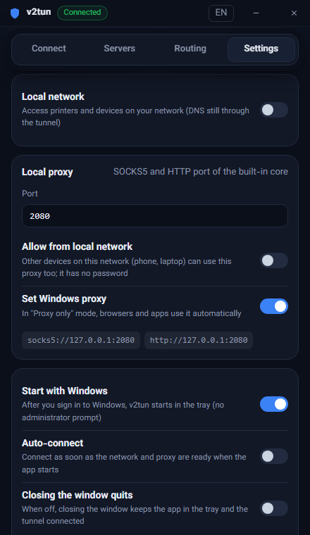

# v2tun

A system-wide tunnel for Windows with a kill switch. v2tun sends the traffic of
every app on the PC through a proxy, using either its own built-in core
(servers and subscriptions inside the app) or the SOCKS port of a running
[v2rayN](https://github.com/2dust/v2rayN).

<p align="center">
  
  
  
</p>

## Features

**Tunnel and protection**
- System-wide TUN tunnel (Wintun) for all Windows apps, not just browsers.
- Kill switch (Windows Filtering Platform): if the tunnel or proxy drops, the
  internet stays blocked instead of falling back to the real connection.
- IPv6 and DNS leak guard, also when the kill switch is off.
- Remote DNS (FakeIP): DNS queries never leave the PC; the server resolves
  names in the exit country, so DNS leak tests come out clean.
- Built-in IP / WebRTC leak test and exit IP display.
- Optional: match the Windows time zone to the server's country.
- Crash safety: a watchdog process restores routes, DNS, the hosts file, the
  time zone and the Windows proxy setting if v2tun is killed.

**Servers**
- Built-in [sing-box](https://github.com/SagerNet/sing-box) core: VLESS
  (Reality, XHTTP via Xray), VMess, Trojan, Shadowsocks, Hysteria / Hysteria2,
  TUIC, WireGuard, NaiveProxy, SOCKS, HTTP, OpenVPN (.ovpn) and
  AnyConnect / OpenConnect / Fortinet / GlobalProtect.
- Subscriptions (base64 links, sing-box and Clash formats) with auto-update.
- Ping, real delay and speed test, per server or for all.
- "Auto (fastest)" with failover that does not interrupt open connections.
- Or use v2rayN instead: v2tun finds it and its cores automatically.

**More**
- Local proxy: SOCKS5 + HTTP on one configurable port, optionally reachable
  from the local network, and a "Proxy only" mode that sets the Windows proxy
  instead of creating a tunnel.
- Split tunneling by app (exe) and by domain / IP range, in "exclude" or
  "include" mode.
- Tray icon, start with Windows (no UAC prompt), auto-connect.
- English, Persian, Arabic and Chinese user interface.

## Requirements

- Windows 10 or 11, 64-bit (x64).
- Administrator rights (needed for the tunnel adapter, routes and firewall).
- [WebView2 runtime](https://developer.microsoft.com/microsoft-edge/webview2/)
  (already included in Windows 11 and up-to-date Windows 10).

## Install

1. Download `v2tun-<version>-windows-amd64.zip` from
   [Releases](../../releases) and check it against `SHA256SUMS.txt`.
2. Unzip it anywhere and run `v2tun.exe` (it asks for administrator rights).
3. Either add servers on the **Servers** tab (paste a link or subscription),
   or choose **v2rayN** as the proxy source while v2rayN is running.
4. Press the power button.

Settings, servers and the log are stored in `C:\ProgramData\v2tun`
(readable only by administrators).

> **Antivirus warning.** v2tun changes the firewall, routes, DNS and the
> hosts file and contains a network driver loader. Unsigned builds of such
> tools are sometimes flagged as false positives. You can always build the
> exe yourself from this source (see below).

## Build from source

Requirements: Go 1.26 (the `go` command downloads the exact toolchain
automatically) and PowerShell. No C compiler is needed.

```powershell
git clone <this repository>
cd v2tun
.\build.ps1                 # or: .\build.ps1 -Version 1.0.0
```

The result is a single `v2tun.exe`; `wintun.dll` and `libcronet.dll` are
embedded in it.

### Tests

```powershell
$tags = 'desktop,production,with_quic,with_utls,with_wireguard,with_gvisor,with_naive_outbound,with_purego,with_openvpn,with_openconnect'
Rename-Item rsrc_windows_amd64.syso rsrc.syso.bak   # the icon resource clashes with test binaries
go test -tags $tags -run 'TestT$|TestRules|TestSniff|TestFakeIP|TestParseLinks|TestNewFormats|TestHostsStrip' .
Rename-Item rsrc.syso.bak rsrc_windows_amd64.syso
```

End-to-end tests that really bring the tunnel up (as Administrator, with
`V2TUN_E2E=1`) and the manual release checklist are described in
[TESTING.md](TESTING.md).

### Translations

All text in the code is English and is translated through
[`frontend/i18n.json`](frontend/i18n.json). `node tools/extract.js` lists
strings that have no translation yet; add them to `tools/tr-extra.json`
(`[["English", "Persian", "Chinese", "Arabic"], …]`) and run
`node tools/mergei18n.js`.

## Project layout

| Path | Purpose |
|---|---|
| `main.go`, `app.go`, `tray.go` | Wails app, UI bindings, tray icon |
| `engine.go`, `handler.go`, `dialer.go` | TUN tunnel (tun2socks / gVisor), routing of each connection |
| `firewall.go` | Kill switch and leak guard (WFP) |
| `fakeip.go`, `dnstcp.go`, `dnsmap.go`, `sysdns.go` | DNS handling |
| `core.go`, `xraycore.go`, `servers.go`, `links.go`, `clash.go`, `ovpn.go` | Built-in core, server list, link and subscription parsing |
| `rules.go`, `sniff.go` | Split tunneling |
| `watchdog.go`, `hosts.go`, `timezone.go`, `sysproxy_windows.go` | System changes and their restoration |
| `frontend/` | UI (plain HTML / CSS / JS) and translations |
| `tools/` | Icon generator, translation and license-notice helpers |

## Releasing

See [RELEASE.md](RELEASE.md). Pushing a tag such as `v1.0.0` makes the GitHub
Actions workflow build the exe and create a draft release with the zip and
checksums.

## Feedback

Found a bug or have an idea? Please [open an issue](../../issues/new/choose).
Remove server addresses, passwords and subscription links from logs before
posting them. Pull requests are not accepted at the moment.

## License

v2tun is licensed under the [GNU General Public License v3.0](LICENSE)
because it includes sing-box and other GPL-licensed libraries. Bundled
third-party components and their licenses are listed in
[THIRD_PARTY_NOTICES.md](THIRD_PARTY_NOTICES.md).

This software is provided as is, without warranty. You are responsible for
using it in accordance with the laws of your country and the terms of your
proxy provider.
