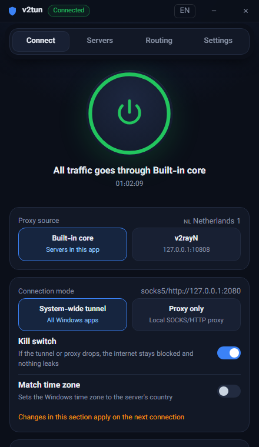
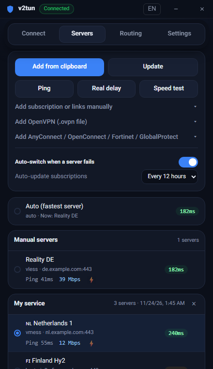
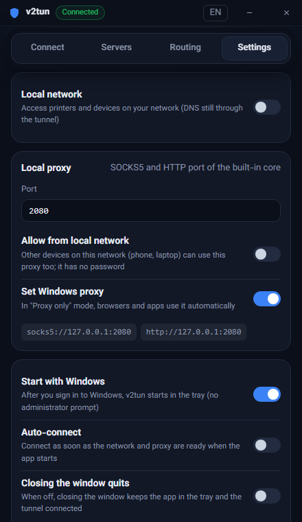

<div dir="rtl">

# v2tun

[English](../README.md) | [فارسی](README.fa.md) | **العربية** | [中文](README.zh.md)

نفق شامل لنظام Windows مع مفتاح إيقاف (Kill Switch). يمرّر v2tun حركة جميع التطبيقات على الحاسوب عبر وكيل (Proxy)، إما بنواته المدمجة (الخوادم والاشتراكات داخل التطبيق) أو عبر منفذ SOCKS لبرنامج [v2rayN](https://github.com/2dust/v2rayN) أثناء تشغيله.

<p align="center">
  
  
  
</p>

## الميزات

**النفق والحماية**
- نفق TUN شامل (Wintun) لكل تطبيقات Windows، وليس للمتصفح فقط.
- مفتاح إيقاف (Windows Filtering Platform): إذا انقطع النفق أو الوكيل يبقى الإنترنت محجوبًا بدل الرجوع إلى الاتصال الحقيقي.
- حماية من تسرب IPv6 وDNS، حتى عند إيقاف مفتاح الإيقاف.
- DNS عن بُعد (FakeIP): لا تغادر طلبات DNS الحاسوب، ويحلّ الخادم الأسماء في بلد الخروج، فتظهر اختبارات تسرب DNS نظيفة.
- اختبار تسرب IP وWebRTC داخل التطبيق مع عرض عنوان IP الخارجي.
- اختياري: مطابقة المنطقة الزمنية لـ Windows مع بلد الخادم.
- أمان عند الإغلاق المفاجئ: عملية مراقبة تعيد المسارات وDNS وملف hosts والمنطقة الزمنية وإعداد الوكيل في Windows.

**الخوادم**
- نواة [sing-box](https://github.com/SagerNet/sing-box) مدمجة: VLESS (Reality، وXHTTP عبر Xray)، VMess، Trojan، Shadowsocks، Hysteria / Hysteria2، TUIC، WireGuard، NaiveProxy، SOCKS، HTTP، OpenVPN (.ovpn) وAnyConnect / OpenConnect / Fortinet / GlobalProtect.
- اشتراكات (روابط base64 وصيغ sing-box وClash) مع تحديث تلقائي.
- Ping وزمن الاستجابة الحقيقي واختبار السرعة لخادم واحد أو للجميع.
- «تلقائي (الأسرع)» مع تبديل تلقائي للخادم دون قطع الاتصالات المفتوحة.
- أو استخدم v2rayN: يعثر v2tun عليه وعلى نواته تلقائيًا.

**المزيد**
- وكيل محلي: SOCKS5 وHTTP على منفذ واحد قابل للضبط، مع إمكانية الوصول من الشبكة المحلية، ووضع «وكيل فقط» يضبط وكيل Windows بدل إنشاء نفق.
- تقسيم النفق حسب التطبيق (exe) وحسب النطاق / نطاق IP، بوضعَي «الكل ما عدا هذه» و«هذه فقط».
- أيقونة بجانب الساعة، تشغيل مع Windows (بدون نافذة UAC)، اتصال تلقائي.
- واجهة بالإنجليزية والفارسية والعربية والصينية.

## المتطلبات

- Windows 10 أو 11، ‏64 بت (x64).
- صلاحيات المسؤول (Administrator) لمحول النفق والمسارات والجدار الناري.
- [WebView2](https://developer.microsoft.com/microsoft-edge/webview2/) (موجود في Windows 11 وفي Windows 10 المحدَّث).

## التثبيت

1. نزّل `v2tun-<version>-windows-amd64.zip` من [Releases](https://github.com/smma91/v2tun/releases) وتحقق منه عبر `SHA256SUMS.txt`.
2. فك الضغط في أي مجلد وشغّل `v2tun.exe` (يطلب صلاحيات المسؤول).
3. أضف خوادم من تبويب **الخوادم** (الصق رابطًا أو اشتراكًا)، أو اختر **v2rayN** مصدرًا للوكيل أثناء تشغيله.
4. اضغط زر التشغيل.

تُحفظ الإعدادات والخوادم والسجل في `C:\ProgramData\v2tun` (للمسؤولين فقط).

> **تحذير مكافح الفيروسات.** يغيّر v2tun الجدار الناري والمسارات وDNS وملف hosts ويحمّل برنامج تشغيل شبكة. قد تُصنَّف النسخ غير الموقّعة من هذه الأدوات خطأً كبرامج ضارة. يمكنك دائمًا بناء الملف التنفيذي بنفسك من هذا المصدر.

## البناء من المصدر

المتطلبات: Go 1.26 (يقوم الأمر `go` بتنزيل الإصدار الصحيح تلقائيًا) وPowerShell. لا حاجة لمترجم C.

<div dir="ltr">

```powershell
git clone https://github.com/smma91/v2tun.git
cd v2tun
.\build.ps1                 # or: .\build.ps1 -Version 1.0.0
```

</div>

الناتج ملف واحد `v2tun.exe` يتضمن `wintun.dll` و`libcronet.dll`. تفاصيل الاختبارات والترجمة في [README الإنجليزي](../README.md).

## الملاحظات والمشاكل

وجدت خطأً أو لديك فكرة؟ [افتح Issue](https://github.com/smma91/v2tun/issues/new/choose). احذف عناوين الخوادم وكلمات المرور وروابط الاشتراك من السجلات قبل نشرها. لا تُقبل طلبات الدمج (Pull Requests) حاليًا.

## الترخيص

يُوزَّع v2tun بموجب [GNU General Public License v3.0](../LICENSE) لأنه يتضمن sing-box ومكتبات أخرى مرخصة بـ GPL. المكونات الخارجية وتراخيصها مذكورة في [THIRD_PARTY_NOTICES.md](../THIRD_PARTY_NOTICES.md).

يُقدَّم هذا البرنامج «كما هو» دون أي ضمان. أنت مسؤول عن استخدامه وفق قوانين بلدك وشروط مزوّد الوكيل.

</div>
