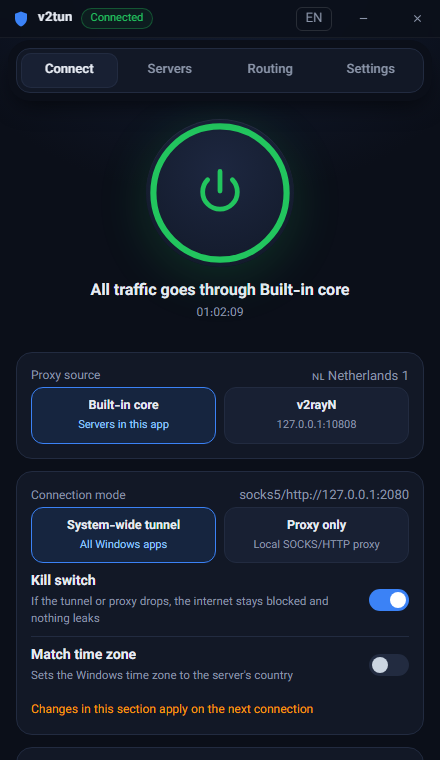
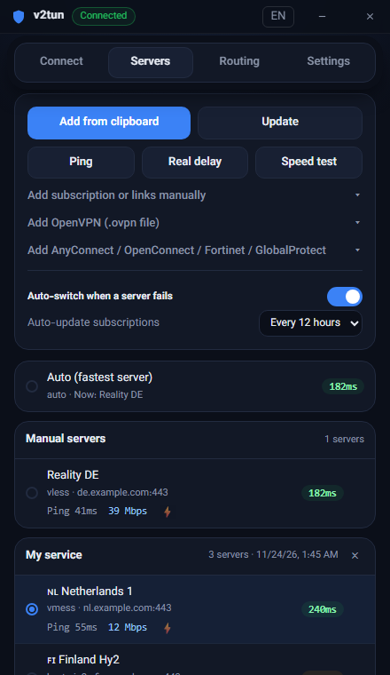
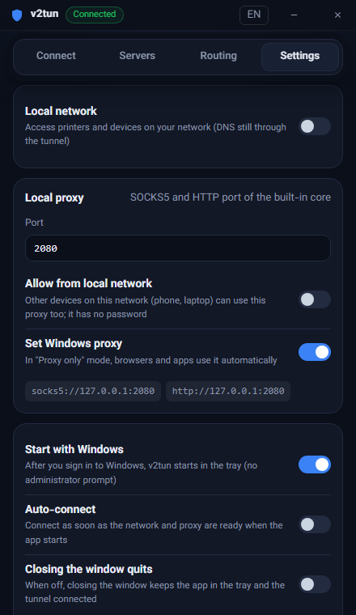

<div dir="rtl">

# v2tun

[English](../README.md) | **فارسی** | [العربية](README.ar.md) | [中文](README.zh.md)

تونل سراسری با کیل‌سوئیچ برای **ویندوز و لینوکس**. v2tun ترافیک همه‌ی برنامه‌های کامپیوتر را از پراکسی عبور می‌دهد؛ یا با هسته‌ی داخلی خودش (سرورها و اشتراک‌ها داخل برنامه) یا از طریق پورت SOCKS برنامه‌ی [v2rayN](https://github.com/2dust/v2rayN) که در حال اجراست.

<p align="center">
  
  
  
</p>

## امکانات

**تونل و محافظت**
- تونل سراسری TUN (با Wintun) برای همه‌ی برنامه‌های ویندوز، نه فقط مرورگر.
- کیل‌سوئیچ (Windows Filtering Platform): اگر تونل یا پراکسی قطع شود، اینترنت بسته می‌ماند و به اتصال واقعی برنمی‌گردد.
- محافظ نشت IPv6 و DNS، حتی وقتی کیل‌سوئیچ خاموش است.
- DNS از راه دور (FakeIP): درخواست‌های DNS از کامپیوتر بیرون نمی‌روند و سرور نام سایت‌ها را در کشور خروجی پیدا می‌کند؛ تست نشت DNS تمیز است.
- تست نشت IP و WebRTC داخل برنامه و نمایش IP خروجی.
- اختیاری: هماهنگ‌کردن منطقه‌ی زمانی ویندوز با کشور سرور.
- ایمن در برابر بسته‌شدن ناگهانی: یک فرایند نگهبان، مسیرها، DNS، فایل hosts، منطقه‌ی زمانی و تنظیم پراکسی ویندوز را برمی‌گرداند.

**سرورها**
- هسته‌ی داخلی [sing-box](https://github.com/SagerNet/sing-box): ‏VLESS (‏Reality، و XHTTP از طریق Xray)، VMess، Trojan، Shadowsocks، Hysteria / Hysteria2، TUIC، WireGuard، NaiveProxy، SOCKS، HTTP، OpenVPN (‏‎.ovpn) و AnyConnect / OpenConnect / Fortinet / GlobalProtect.
- اشتراک (Subscription) با فرمت‌های لینک base64، sing-box و Clash، با به‌روزرسانی خودکار.
- پینگ، تأخیر واقعی و تست سرعت، برای یک سرور یا همه.
- «خودکار (سریع‌ترین)» با تعویض خودکار سرور، بدون قطع اتصال‌های باز.
- یا استفاده از v2rayN: ‏v2tun خودش آن و هسته‌هایش را پیدا می‌کند.

**امکانات دیگر**
- پراکسی محلی: SOCKS5 و HTTP روی یک پورت قابل تنظیم، با امکان دسترسی از شبکه‌ی محلی، و حالت «فقط پراکسی» که به‌جای تونل، پراکسی ویندوز را تنظیم می‌کند.
- تونل تفکیکی بر اساس برنامه (exe) و دامنه / محدوده‌ی IP، در دو حالت «همه به‌جز این‌ها» و «فقط این‌ها».
- آیکون کنار ساعت، اجرا با ویندوز (بدون پیغام UAC)، اتصال خودکار.
- رابط کاربری انگلیسی، فارسی، عربی و چینی.

## پیش‌نیازهای ویندوز

- ویندوز ۱۰ یا ۱۱، ‏۶۴ بیتی (x64).
- دسترسی Administrator (برای کارت شبکه‌ی تونل، مسیرها و فایروال).
- [WebView2](https://developer.microsoft.com/microsoft-edge/webview2/) (در ویندوز ۱۱ و ویندوز ۱۰ به‌روز وجود دارد).

## نصب در ویندوز

1. فایل `v2tun-<version>-windows-amd64.zip` را از [Releases](https://github.com/smma91/v2tun/releases) دانلود کنید و با `SHA256SUMS.txt` مقایسه کنید.
2. آن را در هر پوشه‌ای باز کنید و `v2tun.exe` را اجرا کنید (دسترسی Administrator می‌خواهد).
3. در زبانه‌ی **سرورها** سرور یا اشتراک اضافه کنید (لینک را paste کنید)، یا وقتی v2rayN باز است، منبع پراکسی را **v2rayN** بگذارید.
4. دکمه‌ی روشن/خاموش را بزنید.

تنظیمات، سرورها و گزارش در `C:\ProgramData\v2tun` ذخیره می‌شوند و فقط Administrator به آن‌ها دسترسی دارد.

> **هشدار آنتی‌ویروس.** ‏v2tun فایروال، مسیرها، DNS و فایل hosts را تغییر می‌دهد و درایور شبکه بارگذاری می‌کند. نسخه‌های بدون امضای دیجیتال چنین ابزارهایی گاهی به‌اشتباه ویروس تشخیص داده می‌شوند. همیشه می‌توانید فایل exe را خودتان از همین سورس بسازید.

## لینوکس

**پیش‌نیاز:** توزیع ۶۴ بیتی (x86_64) با WebKitGTK 4.1؛ مثلاً Ubuntu 22.04 به بعد، Debian 12، Linux Mint 21 یا Fedora 37 به بعد.

فایل مناسب را از [Releases](https://github.com/smma91/v2tun/releases) دانلود کنید:

| بسته | نصب |
|---|---|
| `.deb` (Ubuntu, Debian, Mint) | `sudo apt install ./v2tun_<version>_amd64.deb` |
| `.rpm` (Fedora) | `sudo dnf install ./v2tun-<version>-1.x86_64.rpm` |
| `.AppImage` | `chmod +x v2tun-*.AppImage` |
| `.tar.gz` | `sudo ./install.sh` |

بعد **v2tun** را از منوی برنامه‌ها اجرا کنید.

- v2tun با کاربر root اجرا نمی‌شود؛ پنجره با کاربر خودتان باز می‌شود و برنامه فقط دو مجوز شبکه‌ی لازم (`cap_net_admin` و `cap_net_raw`) را می‌گیرد. بسته‌ها و `install.sh` این مجوز را می‌دهند. اگر نداشته باشد (مثلاً AppImage)، دکمه‌ی **دادن اجازه** نمایش داده می‌شود و فقط یک بار رمز را می‌پرسد. AppImage در این مرحله خودش را در `/opt/v2tun` نصب می‌کند.
- برای آیکون کنار ساعت، میزکار باید tray داشته باشد (KDE، Xfce، Cinnamon و Ubuntu دارند؛ در GNOME ساده افزونه‌ی AppIndicator را نصب کنید). بدون tray، بستن پنجره آن را کوچک می‌کند.
- تنظیمات و سرورها در `~/.config/v2tun` ذخیره می‌شوند.

## ساخت از سورس

پیش‌نیاز: Go 1.26 (دستور `go` نسخه‌ی دقیق را خودش دانلود می‌کند) و PowerShell. کامپایلر C لازم نیست.

<div dir="ltr">

```powershell
git clone https://github.com/smma91/v2tun.git
cd v2tun
.\build.ps1                 # or: .\build.ps1 -Version 1.0.0
```

</div>

خروجی یک فایل `v2tun.exe` است و `wintun.dll` و `libcronet.dll` داخل آن قرار دارند.

**لینوکس:**

<div dir="ltr">

```sh
sudo apt install build-essential pkg-config libgtk-3-dev libwebkit2gtk-4.1-dev
./build.sh
sudo setcap cap_net_admin,cap_net_raw+ep ./v2tun
```

</div>

خروجی `v2tun` و `libcronet.so` است که باید کنار هم بمانند. توضیح تست‌ها و ترجمه‌ها در [README انگلیسی](../README.md) آمده است.

## گزارش مشکل و پیشنهاد

اگر مشکلی دیدید یا پیشنهادی دارید، یک [Issue](https://github.com/smma91/v2tun/issues/new/choose) باز کنید. قبل از گذاشتن گزارش (log)، آدرس سرورها، رمزها و لینک اشتراک را از آن پاک کنید. در حال حاضر Pull Request پذیرفته نمی‌شود.

## مجوز

‏v2tun تحت مجوز [GNU General Public License v3.0](../LICENSE) منتشر می‌شود، چون sing-box و کتابخانه‌های دیگری با مجوز GPL را در بر دارد. فهرست اجزای دیگران و مجوزهایشان در [THIRD_PARTY_NOTICES.md](../THIRD_PARTY_NOTICES.md) آمده است.

این نرم‌افزار «همان‌طور که هست» و بدون هیچ ضمانتی ارائه می‌شود. مسئولیت استفاده از آن مطابق قوانین کشور خودتان و شرایط ارائه‌دهنده‌ی پراکسی، با شماست.

</div>
