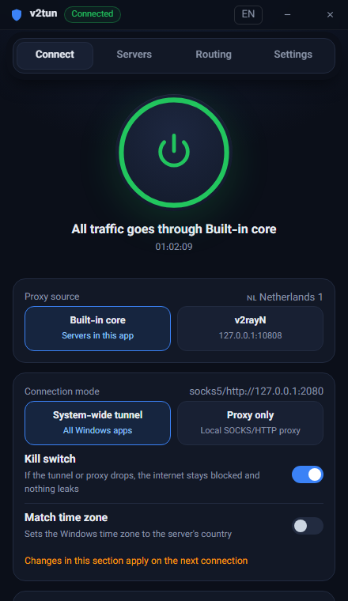
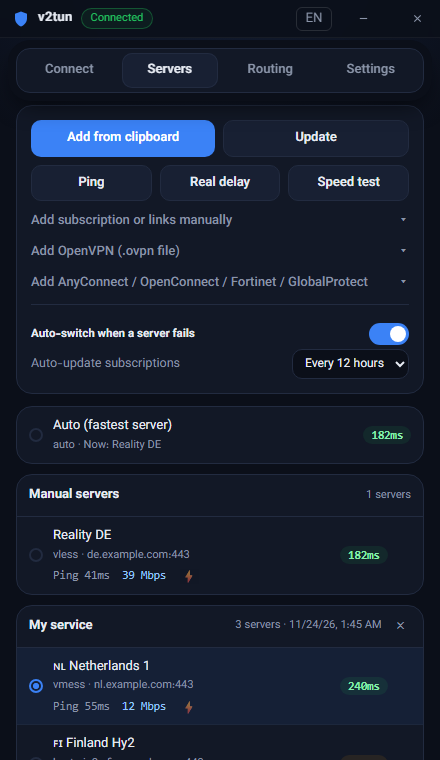
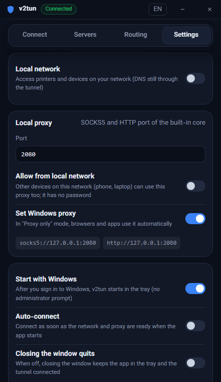

# v2tun

[English](../README.md) | [فارسی](README.fa.md) | [العربية](README.ar.md) | **中文**

带断网保护（Kill Switch）的全局隧道，支持 **Windows 和 Linux**。v2tun 让电脑上所有应用的流量都经过代理：可以使用内置核心（在应用内管理服务器和订阅），也可以使用正在运行的 [v2rayN](https://github.com/2dust/v2rayN) 的 SOCKS 端口。

<p align="center">
  
  
  
</p>

## 功能

**隧道与保护**
- 基于 Wintun 的全局 TUN 隧道，覆盖所有 Windows 应用，而不仅是浏览器。
- 断网保护（Windows Filtering Platform）：隧道或代理断开时，网络保持阻断，不会回落到真实连接。
- IPv6 与 DNS 泄漏防护，即使关闭断网保护也有效。
- 远程 DNS（FakeIP）：DNS 查询不会离开本机，由服务器在出口国家解析域名，DNS 泄漏测试结果干净。
- 内置 IP / WebRTC 泄漏测试，并显示出口 IP。
- 可选：将 Windows 时区与服务器所在国家同步。
- 异常退出保护：守护进程会恢复路由、DNS、hosts 文件、时区和 Windows 代理设置。

**服务器**
- 内置 [sing-box](https://github.com/SagerNet/sing-box) 核心：VLESS（Reality，XHTTP 通过 Xray）、VMess、Trojan、Shadowsocks、Hysteria / Hysteria2、TUIC、WireGuard、NaiveProxy、SOCKS、HTTP、OpenVPN（.ovpn）以及 AnyConnect / OpenConnect / Fortinet / GlobalProtect。
- 订阅（base64 链接、sing-box 和 Clash 格式），支持自动更新。
- Ping、真实延迟和测速，可单个或全部测试。
- “自动（最快）”故障切换，不会中断已有连接。
- 也可以使用 v2rayN：v2tun 会自动找到它及其核心。

**更多**
- 本地代理：SOCKS5 + HTTP 共用一个可配置端口，可选允许局域网访问；“仅代理”模式会设置 Windows 系统代理而不创建隧道。
- 按应用（exe）和域名 / IP 段分流，支持“排除”和“仅包含”两种模式。
- 托盘图标、开机自启（无 UAC 提示）、自动连接。
- 界面支持英语、波斯语、阿拉伯语和中文。

## Windows 系统要求

- Windows 10 或 11，64 位（x64）。
- 管理员权限（用于隧道网卡、路由和防火墙）。
- [WebView2 运行时](https://developer.microsoft.com/microsoft-edge/webview2/)（Windows 11 和已更新的 Windows 10 自带）。

## 在 Windows 上安装

1. 从 [Releases](https://github.com/smma91/v2tun/releases) 下载 `v2tun-<version>-windows-amd64.zip`，并用 `SHA256SUMS.txt` 校验。
2. 解压到任意位置，运行 `v2tun.exe`（会请求管理员权限）。
3. 在 **服务器** 页添加服务器（粘贴链接或订阅），或在 v2rayN 运行时选择 **v2rayN** 作为代理来源。
4. 点击电源按钮。

设置、服务器和日志保存在 `C:\ProgramData\v2tun`（仅管理员可读）。

> **杀毒软件提示。** v2tun 会修改防火墙、路由、DNS 和 hosts 文件，并加载网络驱动。此类工具的未签名版本有时会被误报。你随时可以用本仓库的源码自行编译。

## Linux

**系统要求：** 64 位（x86_64）且带 WebKitGTK 4.1 的发行版，例如 Ubuntu 22.04+、Debian 12、Linux Mint 21 或 Fedora 37+。

从 [Releases](https://github.com/smma91/v2tun/releases) 下载对应文件：

| 安装包 | 安装方式 |
|---|---|
| `.deb` (Ubuntu, Debian, Mint) | `sudo apt install ./v2tun_<version>_amd64.deb` |
| `.rpm` (Fedora) | `sudo dnf install ./v2tun-<version>-1.x86_64.rpm` |
| `.AppImage` | `chmod +x v2tun-*.AppImage` |
| `.tar.gz` | `sudo ./install.sh` |

然后从应用菜单启动 **v2tun**。

- v2tun 不以 root 运行：窗口以当前用户运行，程序只获得两项必要的网络权限（`cap_net_admin`、`cap_net_raw`）。安装包和 `install.sh` 会自动设置；若缺少权限（例如 AppImage），界面会显示 **授予权限** 按钮，只需输入一次密码，AppImage 会同时把自己安装到 `/opt/v2tun`。
- 托盘图标需要桌面支持托盘（KDE、Xfce、Cinnamon、Ubuntu 均支持；纯 GNOME 需安装 AppIndicator 扩展）。没有托盘时，关闭窗口会将其最小化。
- 设置和服务器保存在 `~/.config/v2tun`。

## 从源码构建

需要 Go 1.26（`go` 命令会自动下载对应工具链）和 PowerShell，无需 C 编译器。

```powershell
git clone https://github.com/smma91/v2tun.git
cd v2tun
.\build.ps1                 # 或：.\build.ps1 -Version 1.0.0
```

生成单个 `v2tun.exe`，`wintun.dll` 和 `libcronet.dll` 已内嵌其中。

**Linux：**


```sh
sudo apt install build-essential pkg-config libgtk-3-dev libwebkit2gtk-4.1-dev
./build.sh
sudo setcap cap_net_admin,cap_net_raw+ep ./v2tun
```

生成 `v2tun` 和 `libcronet.so`，两者需放在同一目录。测试与翻译说明见 [英文 README](../README.md)。

## 反馈

发现问题或有建议？请 [提交 Issue](https://github.com/smma91/v2tun/issues/new/choose)。粘贴日志前请删除服务器地址、密码和订阅链接。目前不接受 Pull Request。

## 许可证

由于包含 sing-box 及其他 GPL 授权的库，v2tun 以 [GNU General Public License v3.0](../LICENSE) 发布。第三方组件及其许可证见 [THIRD_PARTY_NOTICES.md](../THIRD_PARTY_NOTICES.md)。

本软件按“原样”提供，不附带任何担保。请遵守你所在国家的法律以及代理服务商的条款。
